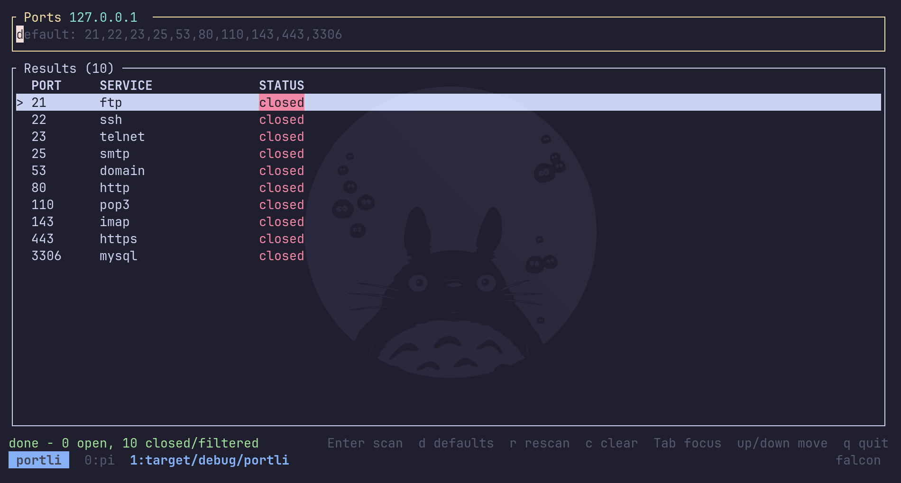

# portli

A small TUI for checking whether TCP ports on a host are open.



Type a port expression, hit `Enter`, and results stream in live. Leave the input
empty to scan the ten common defaults (`21,22,23,25,53,80,110,143,443,3306`).
Scans are concurrent and capped at 1024 ports.

## Install

```sh
curl -fsSL https://raw.githubusercontent.com/sulthonuladib/portli/master/install.sh | sh
```

The script picks the right prebuilt binary, verifies its sha256 checksum, and
installs it to `~/.local/bin` (make sure that is on your `PATH`). Pin a version
or change the location with `VERSION=v0.1.1` / `INSTALL_DIR=...`, or grab an
archive from the [releases](https://github.com/sulthonuladib/portli/releases).

Build from source instead:

```sh
cargo install --path .
```

## Usage

```sh
portli                 # scan 127.0.0.1
portli 192.168.1.1     # scan another host
portli -H example.com  # same, explicit flag
portli --help
```

Port expressions accept lists and ranges: `22`, `22,80,443`, `8000-8010`,
`22 80 443`.

## Keymap

The controls follow Vim where it makes sense, so `j`/`k`, `i`, `/`, `Esc` and
`q` should feel familiar.

**Navigate results**

| Key | Action |
| --- | --- |
| `j` / `↓` | move down (Vim `j`) |
| `k` / `↑` | move up (Vim `k`) |
| `PageDown` / `PageUp` | move by a page |
| `Home` / `End` | jump to the first / last result |
| `Tab` / `Esc` | switch focus between results and input (Vim normal mode) |
| `i` / `/` | focus the port input (Vim insert / search) |

**Run scans**

| Key | Action |
| --- | --- |
| `Enter` | scan the current expression (empty input uses the defaults) |
| `r` / `F5` | rescan |
| `d` | clear input and scan the defaults |
| `c` | clear input and results |
| `q` / `Ctrl-C` | quit (Vim `:q`) |

**Edit the port expression**

| Key | Action |
| --- | --- |
| `0`-`9`, `,`, `-`, `;`, space | type ports and ranges |
| `←` / `→` | move the cursor |
| `Home` / `End` | jump to the start / end of the input |
| `Backspace` / `Delete` | delete |
